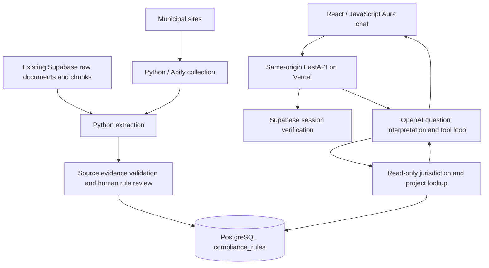

# Architecture

Rules use compound conditions with review timestamps, expiry and source citations.
Missing attributes, conflicting rules or no applicable reviewed rule produce
VERIFY_WITH_JURISDICTION. The model cannot issue permits or execute arbitrary SQL.
The jurisdiction is selected by the user and pinned server-side for tool calls.
Only sources returned by lookups are shown as source links.

## Deployment

Canonical Git repository: `Preclear/Preclear-Astra`, branch `main`.
Vercel project: `daniels-projects-69d87235/preclear-astra`.
Production domains: `www.preclearai.net` and `preclear-astra.vercel.app`.
The existing Vite deployment also builds `api/index.py`; `/api/*` is routed to
FastAPI before the SPA fallback. Vercel supports Python functions alongside
frontend builds: https://vercel.com/docs/functions/runtimes/python/api-directory.

Configure existing VITE_SUPABASE_URL / VITE_SUPABASE_ANON_KEY (or server aliases
SUPABASE_URL / SUPABASE_ANON_KEY), and server-only PERMIT_DATABASE_URL,
OPENAI_API_KEY and OPENAI_MODEL. The database login must be a member of permit_api,
with access only to reviewed rules and jurisdiction identifiers/names.

Apply `supabase/migrations/025_compliance_rules.sql` to the existing municipal
PostgreSQL database after restoring access. It requires the existing
`jurisdictions(id UUID, name TEXT)` source table; it does not create or populate
municipal coverage. Existing RLS policies on jurisdictions must permit the runtime
role to read those public identifiers. Import manually reviewed rules using the
municipal CLI. Do not run legacy database reset scripts.

`/api/health` only verifies that code is running and settings are present.
Authenticated jurisdiction, lookup and conversation smoke tests are required
before claiming live data/model readiness. Configure platform request quotas
before broad availability. Database and OpenAI credentials are never sent to the
browser. Provider requests have bounded timeouts and a four-round tool limit.

The prior changes to `Daniel21b/permitsaas` were made against the wrong repository.
They remain historical; this repository now owns the application implementation.
